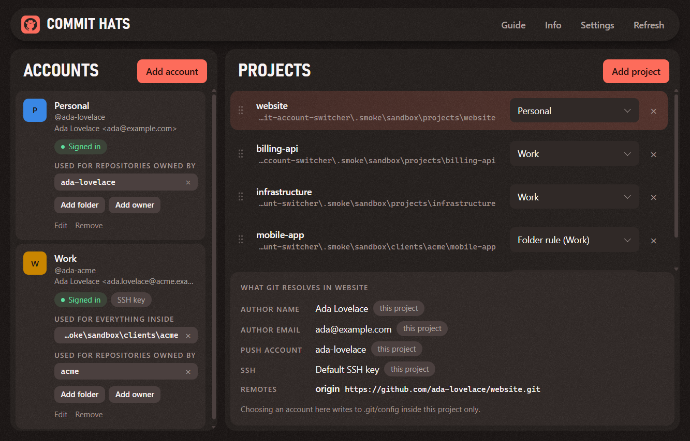

# Commit Hats

**The right GitHub account for every commit.**

Commit Hats for Git picks which account your local projects commit and push as: one project at a time, a whole folder at once, or by who owns the remote. Your global name, email, and credentials never change, and nothing has to keep running in the background.



## Install

Download the installer from this repository's Releases page and run it. It installs for your user only, without administrator rights, and adds a Start menu shortcut. You need Git on your computer.

The installer is not code-signed yet, so Windows SmartScreen warns about it. [SECURITY.md](SECURITY.md) says what the app reads, writes, and runs, and how to check your download.

To run it from the source instead:

```bash
npm install
npm start
```

## First steps

1. **Add account**: the name and email for your commits, and the GitHub username you push with.
2. Give the account a way to authenticate:
   - Over HTTPS, **Sign in** next to the account. Git Credential Manager opens its own window; the app never sees your password or token.
   - Over SSH, **Choose file** to use a key you already have, or **Generate** a new one, **Copy** its public key, and add it on github.com under Settings, SSH and GPG keys.
3. Tell git where the account applies:
   - **Add folder**, to use it for every repository inside a folder.
   - **Add owner**, to use it for every repository whose remote belongs to a GitHub user or organization.
   - **Add project** and choose the account in its dropdown, to set a single repository.

From then on, every `git commit`, `git push`, and `git clone` in those places uses that account, from any terminal or editor. You can close the app.

### Around the app

| Button | What it does |
|--------|--------------|
| **Guide** | Walks you through the app, one area at a time. It opens by itself the first time. |
| **Info** | Shows the versions of the app, Git, Git Credential Manager, and Electron, and where your data is kept. **Copy versions** copies them for a bug report, without any path of your computer. |
| **Settings** | Language (English or Spanish) and theme (same as the system, light, or dark). The app starts in Spanish on a system set to Spanish, and in English otherwise. |
| **Refresh** | Reads git again, for when you changed something outside the app. |

An account that is signed in to Git Credential Manager shows a green **Signed in** mark.

To put the projects in another order, drag one by the dots on its left, or move the focus to the dots and press the up or down arrow. The order only changes what the app shows.

### Requirements

| Tool | Version | Needed for |
|------|---------|------------|
| Node.js | 20 or newer | Running from source and building. The installed app does not need it. |
| Git | 2.36 or newer | Reading and writing config. Owner rules need 2.36. |
| Git Credential Manager | Tested with 2.2.1 | Signing in to several accounts over HTTPS. It ships with Git for Windows. |
| OpenSSH client (`ssh-keygen`) | Any | Generating keys from the app. It ships with Windows 10 and 11. |

Developed and tested on Windows 11. macOS and Linux are untested.

## Rule or project?

| | Folder rule | Owner rule | Project assignment |
|---|-------------|------------|--------------------|
| Covers | Every repository inside the folder | Every repository whose remote is `github.com/<owner>/...`, wherever it is | One repository |
| Applies to later clones | Yes | Yes, from the clone itself | No |
| Written to | Your global git config | Your global git config | The project's own `.git/config` |

When more than one applies, the most specific wins:

1. A project assignment.
2. An owner rule.
3. The folder rule of the deepest folder.

Rules are the only thing that makes the app write to your global git config, and it asks first. What a rule adds is a pointer to a file with the account's settings:

```ini
[includeIf "gitdir/i:C:/Users/ada/clients/acme/"]
    path = C:/Users/ada/AppData/Roaming/git-account-switcher/accounts/<account id>.gitconfig
[includeIf "hasconfig:remote.*.url:git@github.com:[aA][cC][mM][eE]/**"]
    path = C:/Users/ada/AppData/Roaming/git-account-switcher/accounts/<account id>.gitconfig
```

An owner rule writes one entry per URL form (`git@github.com:`, `ssh://git@github.com/`, and `https://github.com/`). The bracketed letters make it match however the owner is capitalized in the remote. Removing a rule in the app removes its entries again.

## What an account sets

Whether it comes from a rule or a project assignment, an account sets the same things.

| Setting | Value | Effect |
|---------|-------|--------|
| `user.name`, `user.email` | From the account | The commit author |
| `credential.https://github.com.username` | The GitHub username | Which stored sign-in git asks the credential manager for |
| `core.sshCommand` | `ssh -i '<key>' -o IdentitiesOnly=yes`, or your usual SSH command when the account has no key | Which SSH key is used |

The SSH command is always set, even without a key. Git settings only add up, so leaving it out would let the key of another account leak in from a broader rule.

A project assignment also keeps `accountswitcher.*` entries in the project: which account is assigned, and the values the project had before. Choosing the first option of the dropdown removes all of it and puts those values back.

## SSH keys

**Generate** creates an ed25519 key pair in `~/.ssh`, named after the account label (`id_ed25519_work` for "Work"), and shows the public key so you can copy it. It never replaces an existing file.

The key is created without a passphrase, so the app never handles a secret. To add one afterwards:

```bash
ssh-keygen -p -f ~/.ssh/id_ed25519_work
```

## What it never touches

- Your global `user.name`, `user.email`, and credential settings.
- Includes and other entries you wrote in the global config yourself.
- Passwords and tokens. They stay in your credential manager.
- Remotes, branches, and commits.

The app keeps its own data in `%APPDATA%\git-account-switcher` on Windows: `state.json` (account labels, names, emails, usernames, SSH key paths, the list of project folders in the order you gave them, and your settings) and `accounts/` (the settings files that rules include). The folder carries the app's first name and stays there, because the rules in your git config point into it.

## When git would ignore the account

The app flags these in the project's detail panel.

| Situation | What git does | Fix |
|-----------|---------------|-----|
| You're not signed in as the account | Asks you to sign in on the next push | **Sign in** next to the account |
| The remote URL pins a user (`https://someone@github.com/...`) | Uses that user | Remove the user from the URL with `git remote set-url` |
| The remote URL embeds a token | Uses that token | Remove it from the URL |
| The remote uses SSH and the account has no key | Uses your default SSH key | Add a key to the account, or switch the remote to HTTPS |
| The remote is not on github.com | Only the commit author changes | Nothing; other hosts are out of scope |
| The project config no longer matches its account | Uses what the config says | Choose the account again |

## Check that it works

Run these inside a repository that should use the account.

- [ ] `git config --show-origin --get user.email` prints the account's email. The file it names is `.git/config` for a project assignment, or a file in the app's `accounts` folder for a rule.
- [ ] `git config --global --get user.email` prints the same value it did before you used the app.
- [ ] Over HTTPS: `git credential-manager github list` includes the account.
- [ ] Over SSH: `ssh -T -i ~/.ssh/id_ed25519_work -o IdentitiesOnly=yes git@github.com` greets you with the account's username.
- [ ] A push to a repository that only this account can write to goes through.

## Limits

- The push account is only switched for github.com.
- Switching over HTTPS relies on a credential helper that can hold several accounts, such as Git Credential Manager.
- An owner rule needs the repository to have a remote, and only covers the three URL forms listed above.
- A rule only takes effect below your default identity in the global config. The app appends rules at the end; if you later add a `[user]` section after them, remove the rule and add it again.
- A folder whose path contains `*`, `?`, or brackets can't have a rule, because git reads those characters as a pattern.
- Because an account always sets `core.sshCommand`, it takes precedence over the `GIT_SSH` environment variable. If you rely on that variable, set `core.sshCommand` in your global config instead and the app will use it.
- Removing a project from the list leaves its git config as it is. Choose the first option of its dropdown before removing it if you want it cleared.

## Development

| Command | What it does |
|---------|--------------|
| `npm test` | Unit and integration tests. They run the real git and ssh-keygen in a sandbox with its own "global" config. |
| `npm run smoke` | Boots the app against throwaway repositories, drives the page with real key presses and a real drag, checks the result with git, and saves screenshots to `.smoke/`. It then opens the app a second time to check that the language, the theme, and the order of the projects were kept. |
| `npm start` | Runs the app. Set `COMMITHATS_DATA_DIR` to try it with a separate data folder. |
| `npm run dist` | Builds the Windows installer into `dist/`, with its checksum in `dist/SHA256SUMS.txt`. |
| `npm run noise` | Rebuilds the grain tiles in `src/assets/`. The output is deterministic. |

```text
src/
  core/        The rules, with no Electron: accounts, assignments, rules, settings, use cases
  adapters/    Git, ssh-keygen, the file system, and JSON storage
  i18n/        Everything the app says, in English and Spanish
  main/        Electron main process: window, IPC, preload
  renderer/    The page: views (presentational) and app (container)
tests/         Tests for core, adapters, and the dictionaries
scripts/       The end-to-end smoke run
```

The core never writes a sentence. It reports what happened as a code with its values, such as `{ code: 'folder.taken', params: { folder, account } }`, and the page says it in the language you chose. To add a language:

1. Write its dictionary in `src/i18n/`, with the same codes as `en.js`.
2. Register it, with its name, in `src/i18n/translator.js`.
3. Allow it as a setting in `src/core/settings.js`. Add it to `languageForLocale` there too, if the app should start in it on a system set to that language.

`npm test` fails until the three agree and the new dictionary says everything the English one does.

## License

Commit Hats is open source under the [Apache License 2.0](LICENSE). Copyright 2026 Nacho Chiappero. See [NOTICE](NOTICE).

Electron and Chromium, which the installed app runs on, keep their own licenses. The installer puts them next to the program.
